# Admin Panel — Features & Flows

React + Vite + Ant Design (dark theme) + TanStack Query + Socket.IO client. It manages the catalogue, orders, users, coupons, shipping, CMS pages and site content.
Routes: [src/App.jsx](src/App.jsx). API layer: [src/services/api.js](src/services/api.js) (`fetchApi` sends `Authorization: Bearer authToken`). Layout: [src/components/layout/](src/components/layout/).

Each section has four diagrams:

1. **Architecture overview**: the pages, components and APIs involved
2. **Action-loop workflow**: admin action → API → state → re-render, repeated
3. **Sequence**: the call order between the admin, the UI and the server
4. **Events / data flow**: what data, storage keys and socket events move where

---

## Contents

- [0. Whole admin panel](#0-whole-admin-panel)
- [1. Auth & route protection](#1-auth--route-protection)
- [2. Dashboard](#2-dashboard)
- [3. Catalog management (Categories, Subcategories, Products, Colors, Sizes)](#3-catalog-management)
- [4. Orders](#4-orders)
- [5. Users & Customers](#5-users--customers)
- [6. Coupons](#6-coupons)
- [7. Shipping rates](#7-shipping-rates)
- [8. CMS Pages & Site Content](#8-cms-pages--site-content)
- [9. Real-time notifications](#9-real-time-notifications)
- [Notes from the code](#notes-from-the-code)

---

## 0. Whole admin panel

### Architecture overview

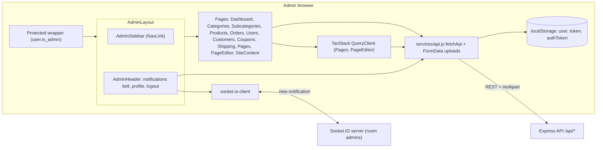

### Action-loop workflow (generic CRUD page)

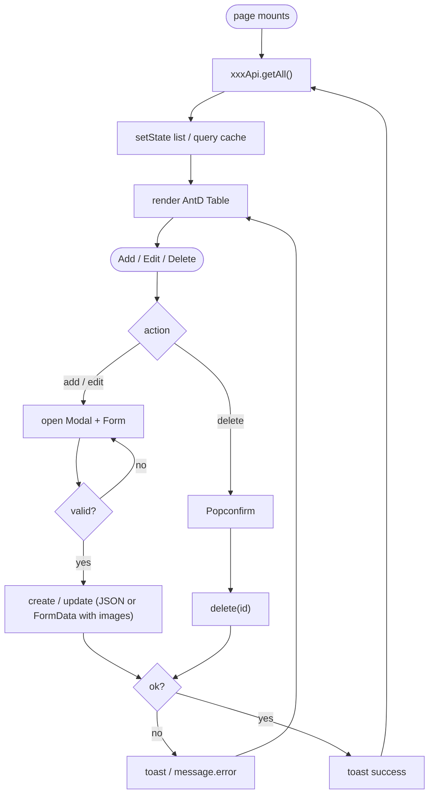

### Sequence (admin session)

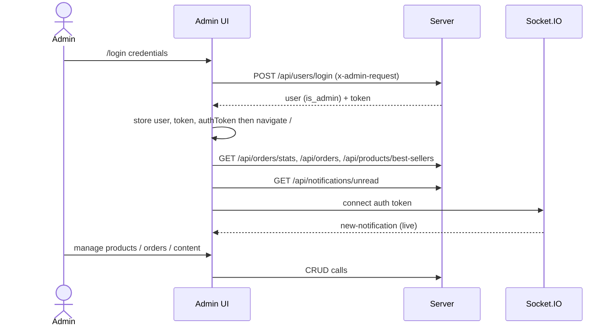

### Events / data flow

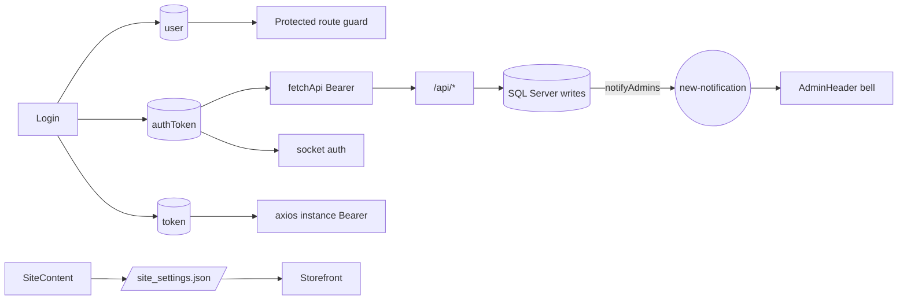

---

## 1. Auth & route protection

Files: [src/pages/Login.jsx](src/pages/Login.jsx), `Protected` in [src/App.jsx](src/App.jsx), logout in [src/components/layout/AdminHeader.jsx](src/components/layout/AdminHeader.jsx).

### Architecture overview

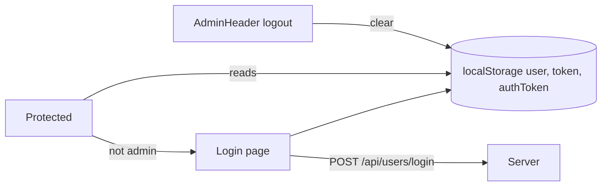

### Action-loop workflow

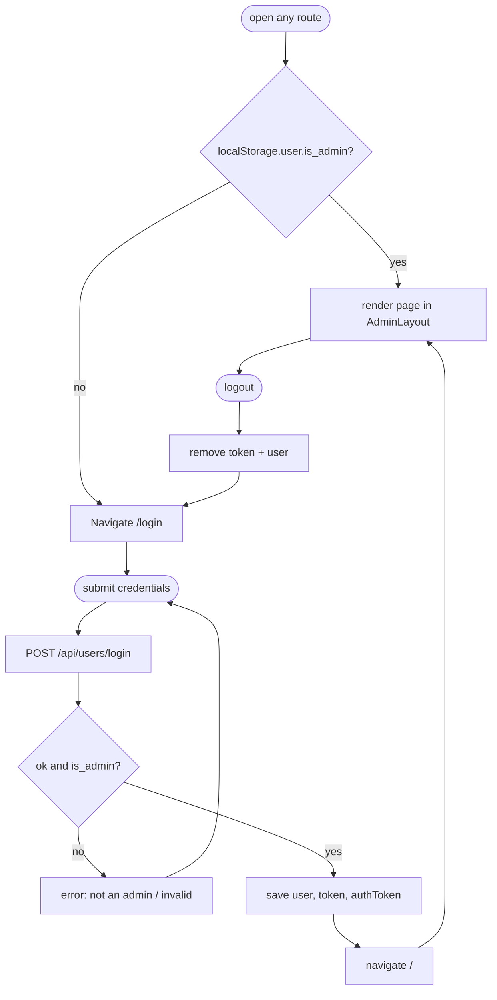

### Sequence

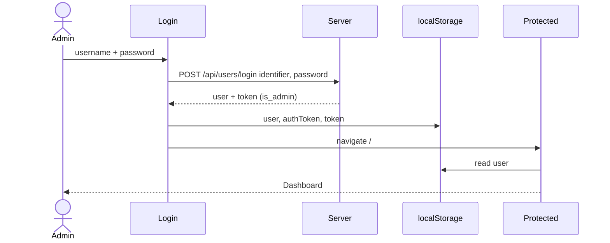

### Events / data flow

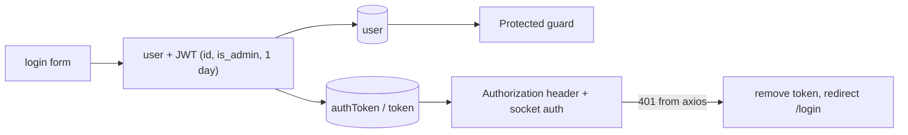

---

## 2. Dashboard

Files: [src/pages/Dashboard.jsx](src/pages/Dashboard.jsx), [src/components/dashboard/StatCard.jsx](src/components/dashboard/StatCard.jsx), [src/components/dashboard/RecentOrders.jsx](src/components/dashboard/RecentOrders.jsx), [src/components/dashboard/TopProducts.jsx](src/components/dashboard/TopProducts.jsx).

### Architecture overview

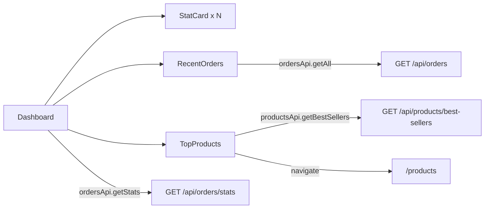

### Action-loop workflow

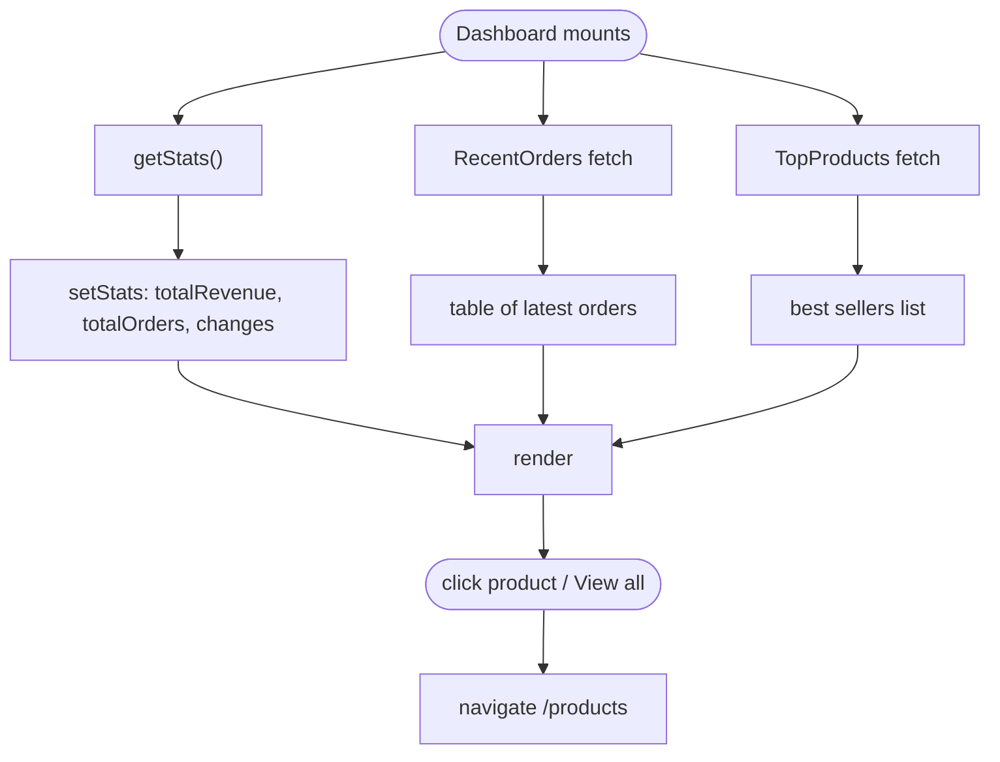

### Sequence

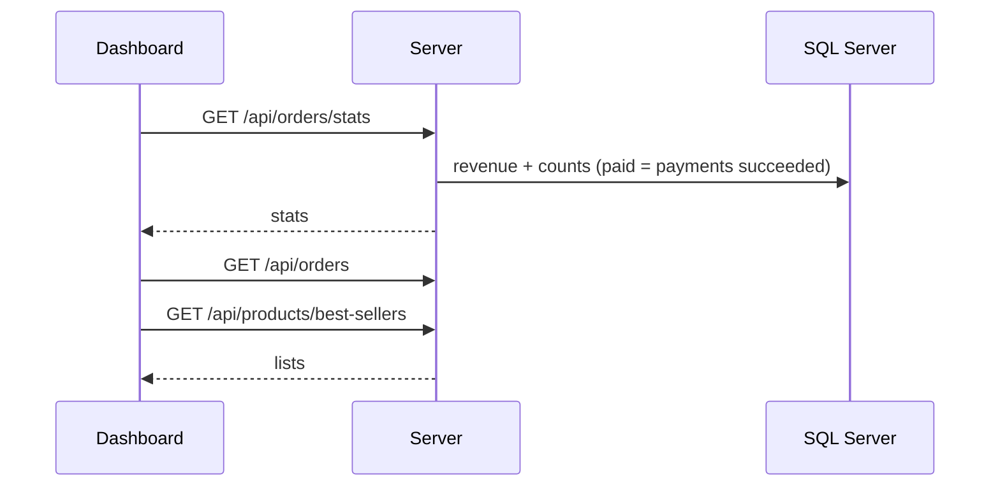

### Events / data flow

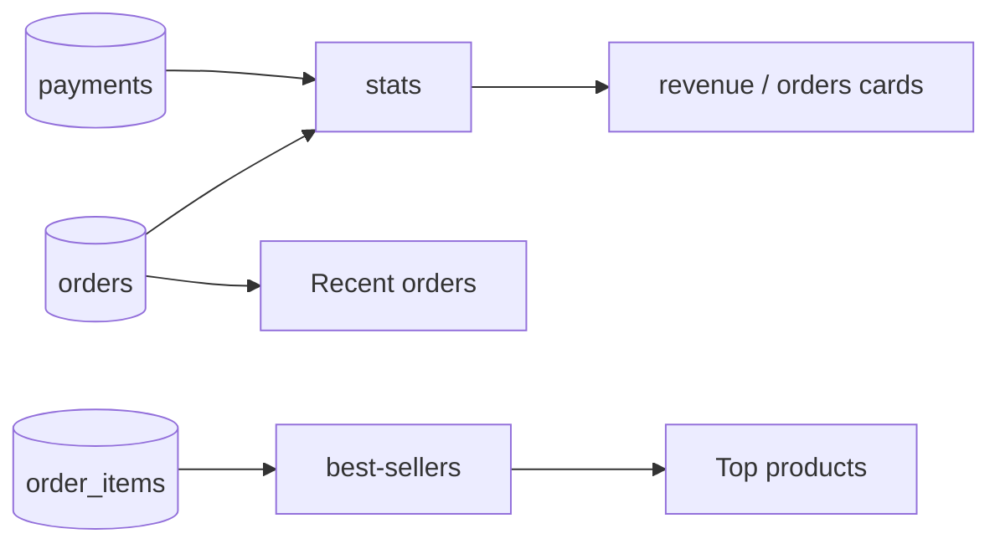

---

## 3. Catalog management

Files: [src/pages/Categories.jsx](src/pages/Categories.jsx), [src/pages/Subcategories.jsx](src/pages/Subcategories.jsx), [src/pages/Products.jsx](src/pages/Products.jsx); APIs `categoriesApi`, `subcategoriesApi`, `productsApi`, `colorsApi`, `sizesApi`.

### Architecture overview

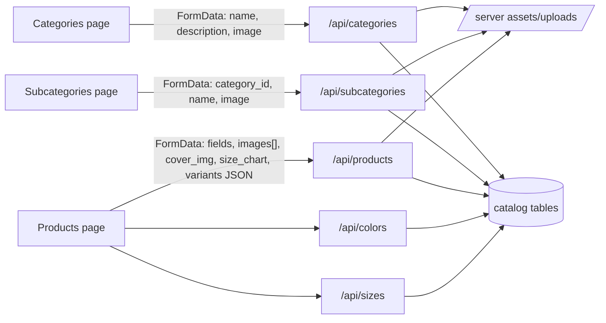

### Action-loop workflow (product editor)

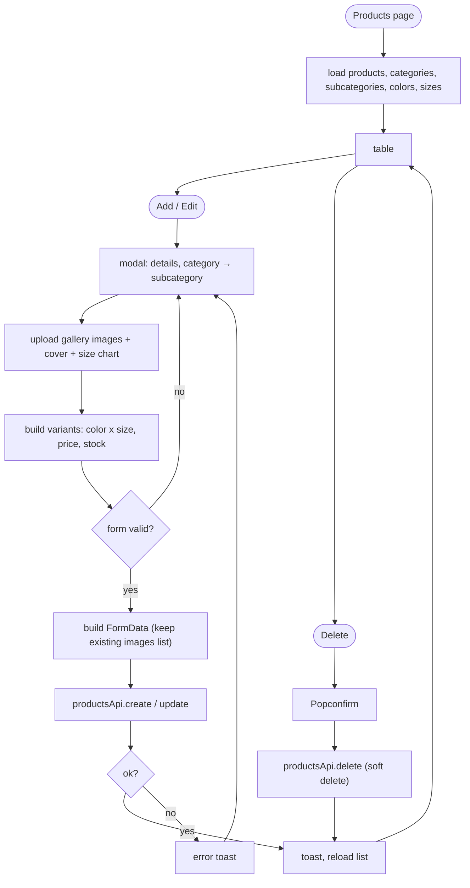

### Sequence

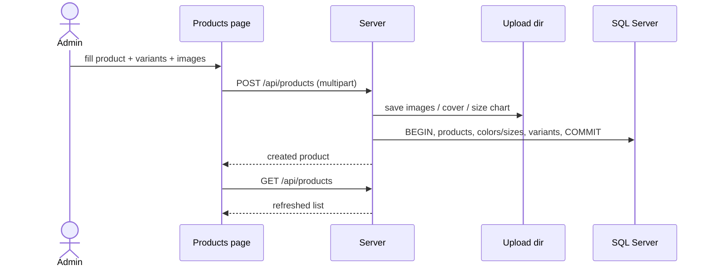

### Events / data flow

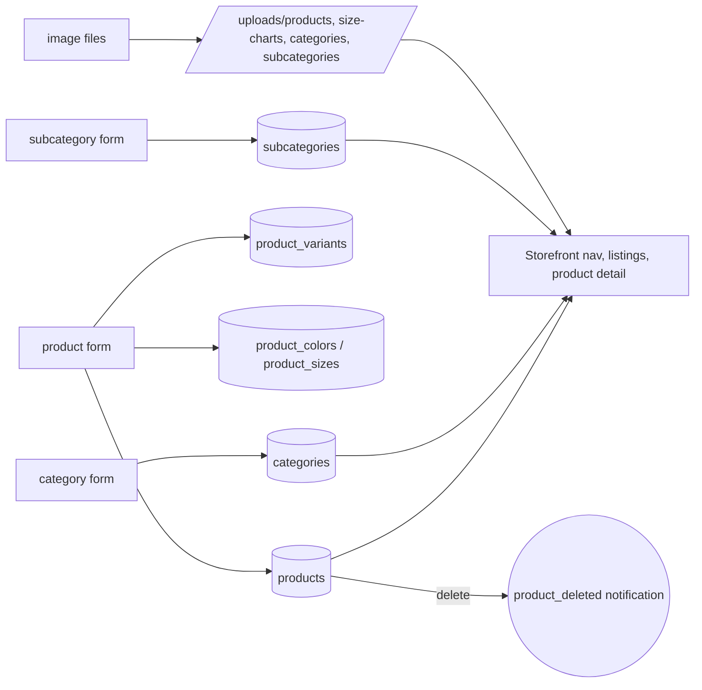

---

## 4. Orders

Files: [src/pages/Orders.jsx](src/pages/Orders.jsx); `ordersApi.getAll`, `getById`, `updateStatus`.
Statuses: `pending`, `processing`, `shipped`, `delivered`, `cancelled`.

### Architecture overview

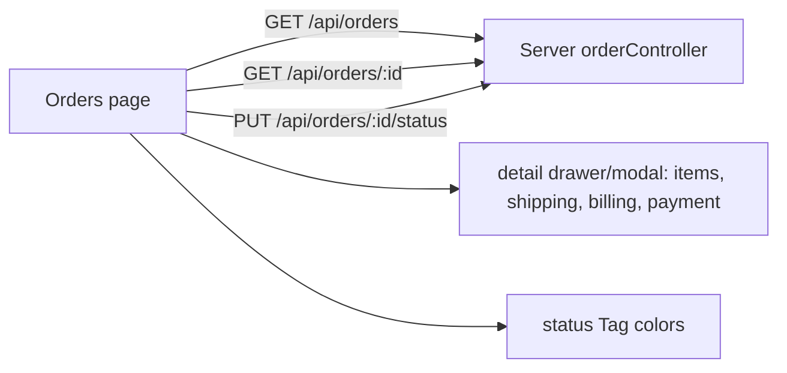

### Action-loop workflow

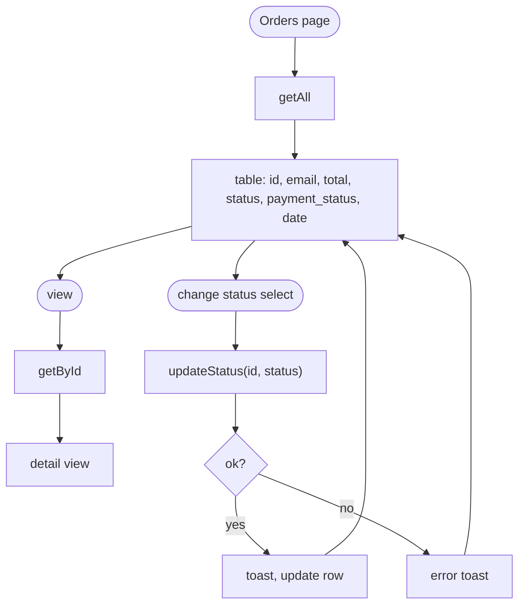

### Sequence

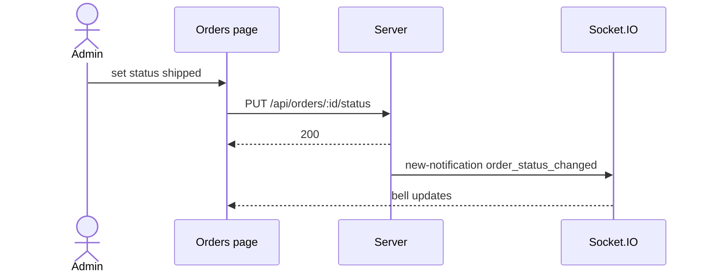

### Events / data flow

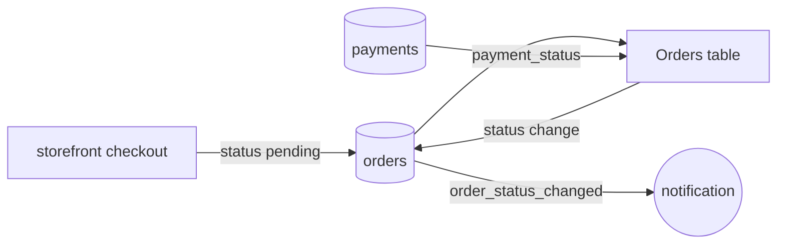

---

## 5. Users & Customers

Files: [src/pages/Users.jsx](src/pages/Users.jsx), [src/pages/Customers.jsx](src/pages/Customers.jsx); `usersApi`.

### Architecture overview

```mermaid
flowchart LR
    U["Users page"] -->|"GET /api/users, PUT /:id, DELETE /:id"| API
    U -->|is_admin toggle/flag| API
    C["Customers page"] -->|GET /api/users/customers| API
    API["Server userController"] --> DB[("users + credentials")]
```

### Action-loop workflow

```mermaid
flowchart TD
    A([Users page]) --> B["getAll"] --> C["table with admin badge"]
    C --> D([edit]) --> E["modal: name, email, role is_admin"] --> F["update(id)"] --> B
    C --> G([delete]) --> H["Popconfirm"] --> I["delete(id)"] --> B
    J([Customers page]) --> K["getCustomers"] --> L["read-only table of buyers"]
```

### Sequence

```mermaid
sequenceDiagram
    actor A as Admin
    participant U as Users page
    participant API as Server
    participant DB as SQL Server
    A->>U: open Users
    U->>API: GET /api/users
    API->>DB: users JOIN credentials
    API-->>U: list
    A->>U: promote to admin
    U->>API: PUT /api/users/:id is_admin
    API->>DB: UPDATE users / credentials
    API-->>U: 200
```

### Events / data flow

```mermaid
flowchart LR
    REG["storefront signup"] --> US[("users / credentials")]
    REG -->|user_registered| N(("notification"))
    CO["checkout saveUser"] --> US
    US --> UL["Users table"]
    US --> CL["Customers table"]
    UL -->|edit / delete| US
```

---

## 6. Coupons

Files: [src/pages/Coupons.jsx](src/pages/Coupons.jsx), coupon actions inside `AdminHeader` notifications; `couponsApi`.

### Architecture overview

```mermaid
flowchart LR
    CP["Coupons page"] -->|CRUD| API["/api/coupons"]
    HD["AdminHeader bell: coupon_limit_reached"] -->|"Deactivate (PUT status) / Delete"| API
    API --> DB[("coupons")]
```

### Action-loop workflow

```mermaid
flowchart TD
    A([Coupons page]) --> B["getAll"] --> C["table: code, type, value, validity, usage used/limit, status"]
    C --> D([create / edit]) --> E["modal form"] --> F{"code unique?"}
    F -- no --> G["409 Code already exists"] --> E
    F -- yes --> H["save"] --> B
    N([bell: limit reached]) --> O{"admin choice"}
    O -- Deactivate --> P["update status inactive"] --> Q["mark notification read"]
    O -- Delete --> R["delete coupon"] --> Q
```

### Sequence

```mermaid
sequenceDiagram
    participant SF as Storefront checkout
    participant API as Server
    participant IO as Socket.IO
    participant HD as AdminHeader
    actor A as Admin
    SF->>API: order with couponCode
    API->>API: used_count reaches usage_limit
    API->>IO: new-notification coupon_limit_reached (couponId)
    IO-->>HD: show with Deactivate / Delete
    A->>HD: Deactivate
    HD->>API: PUT /api/coupons/:id status inactive
    HD->>API: POST /api/notifications/:id/read
```

### Events / data flow

```mermaid
flowchart LR
    F["coupon form"] --> C[("coupons")]
    C -->|validate| SF["storefront checkout"]
    SF -->|used_count + 1| C
    C -->|limit reached| N(("coupon_limit_reached")) --> B["bell actions"] --> C
```

---

## 7. Shipping rates

Files: [src/pages/Shipping.jsx](src/pages/Shipping.jsx); `shippingApi`.

### Architecture overview

```mermaid
flowchart LR
    S["Shipping page"] -->|"GET / POST / PUT :id / DELETE :id"| API["/api/shipping"] --> DB[("shipping_rates")]
    SC["SiteContent: default_intl_shipping_fee"] --> JSON[/"site_settings.json"/]
    DB & JSON --> SF["storefront Cart / Checkout fee"]
```

### Action-loop workflow

```mermaid
flowchart TD
    A([Shipping page]) --> B["getAll"] --> C["table: country, code, fee, currency, est. days, status"]
    C --> D([add / edit]) --> E["modal: pick country, fee, days, active"] --> F["create / update"] --> B
    C --> G([delete]) --> H["remove"] --> B
```

### Sequence

```mermaid
sequenceDiagram
    actor A as Admin
    participant S as Shipping page
    participant API as Server
    participant SF as Storefront
    A->>S: add Morocco 10 EUR
    S->>API: POST /api/shipping
    API-->>S: created
    SF->>API: GET /api/shipping/Morocco
    API-->>SF: fee 10
```

### Events / data flow

```mermaid
flowchart LR
    F["rate form"] --> R[("shipping_rates")]
    R --> CART["Cart delivery charge"]
    R --> CO["Checkout fee + server total"]
    DEF[/"default intl fee"/] -->|fallback| CO
```

---

## 8. CMS Pages & Site Content

Files: [src/pages/Pages.jsx](src/pages/Pages.jsx), [src/pages/PageEditor.jsx](src/pages/PageEditor.jsx) (React-Quill + TanStack Query), [src/pages/SiteContent.jsx](src/pages/SiteContent.jsx); `pagesApi`, `siteSettingsApi`.

### Architecture overview

```mermaid
flowchart LR
    PL["Pages list"] -->|"useQuery ['pages']"| P["/api/pages"]
    PE["PageEditor /pages/create, /pages/edit/:slug"] -->|"useQuery ['page', slug] + useMutation"| P
    SC["SiteContent"] -->|"GET / PUT"| S["/api/site-settings"]
    SC -->|"logo, hero, intro-image, payment-icon"| U["/api/site-settings/upload/*"]
    SC -->|section links| PE
    P --> DB[("pages")]
    S & U --> JSON[/"site_settings.json + uploads/site"/]
```

### Action-loop workflow

```mermaid
flowchart TD
    A([Pages list]) --> B["useQuery pages"] --> C["table"] --> D([edit / create]) --> E["PageEditor loads page by slug"]
    E --> F["edit title, slug, rich content"] --> G["mutation create / update"]
    G --> H["invalidateQueries pages"] --> B
    S([SiteContent]) --> T["GET settings"] --> U["form: hero, intro, footer, product info, payment methods, default shipping fee"]
    U --> V([upload image]) --> W["POST upload/*"] --> X["URL into form"] --> U
    U --> Y([save]) --> Z["PUT /api/site-settings"] --> T
```

### Sequence

```mermaid
sequenceDiagram
    actor A as Admin
    participant E as PageEditor
    participant Q as QueryClient
    participant API as Server
    A->>E: open /pages/edit/privacy-policy
    E->>Q: useQuery page, slug
    Q->>API: GET /api/pages/privacy-policy
    API-->>E: page
    A->>E: edit + save
    E->>API: PUT /api/pages/privacy-policy
    API-->>E: 200
    E->>Q: invalidateQueries pages
```

### Events / data flow

```mermaid
flowchart LR
    Q["Quill HTML"] --> PG[("pages")] --> SFP["storefront info pages (usePageContent)"]
    SF["SiteContent form"] --> JS[/"site_settings.json"/] --> SFS["storefront useSiteSettings: hero, intro, footer, icons"]
    IMG["uploaded images"] --> UP[/"uploads/site"/] --> JS
    JS -->|default_intl_shipping_fee| CK["server checkout"]
```

---

## 9. Real-time notifications

Files: [src/components/layout/AdminHeader.jsx](src/components/layout/AdminHeader.jsx); `notificationsApi` (`getUnread`, `markAsRead`, `markAllAsRead`).

### Architecture overview

```mermaid
flowchart LR
    HD["AdminHeader"] -->|"on mount + every 30s"| R["GET /api/notifications/unread"]
    HD --> IO["socket.io-client auth token"] <-->|"room admins: new-notification"| SRV["Socket.IO server"]
    HD -->|"click item"| MR["POST /:id/read"]
    HD -->|"Mark all as read"| MA["POST /mark-all-read"]
    HD -->|coupon_limit_reached actions| CP["couponsApi"]
```

### Action-loop workflow

```mermaid
flowchart TD
    A([header mounts]) --> B["load unread"] --> C["notifications state"]
    A --> D["socket connect"] --> E(("new-notification")) --> F["prepend to state"] --> C
    A --> P["setInterval 30s"] --> B
    C --> G["badge = count of is_read = 0"] --> H([open bell])
    H --> I([click item]) --> J["markAsRead"] --> K["set is_read = 1 locally"] --> C
    H --> L([Mark all]) --> M["markAllAsRead"] --> C
    X([unmount]) --> Y["clearInterval + socket.close"]
```

### Sequence

```mermaid
sequenceDiagram
    participant HD as AdminHeader
    participant API as Server REST
    participant IO as Socket.IO
    participant SF as Storefront
    HD->>API: GET /api/notifications/unread
    API-->>HD: list
    HD->>IO: connect auth token
    IO->>IO: verify is_admin, join admins
    SF->>API: POST /api/checkout
    API->>IO: emit new-notification order_created
    IO-->>HD: notification
    HD->>HD: prepend, badge +1
    HD->>API: POST /api/notifications/:id/read
```

### Events / data flow

```mermaid
flowchart LR
    T1["order_created"] & T2["order_status_changed"] & T3["stock_low"] & T4["product_deleted"] & T5["user_registered"] & T6["coupon_limit_reached"] --> DB[("notifications")]
    DB -->|socket new-notification| ST["header state"]
    DB -->|REST unread poll| ST
    ST --> BADGE["badge count"] & LIST["dropdown list"]
    LIST -->|read| DB
    LIST -->|coupon actions| CP[("coupons")]
```

---

## Notes from the code

I noticed these things while tracing the flows above. The diagrams show the code as it is.

- Route protection is client-side only, through `localStorage.user.is_admin`. The server does not check the token on admin endpoints.
- `Login.jsx` posts to `VITE_API_URL`, while everything else uses `VITE_BACKEND_SERVER_URL`. Both env vars must be set.
- The token is stored twice: `authToken` is used by `fetchApi` and the socket, and `token` is used by the axios instance. Logout removes `token` and `user`, but not `authToken`.
- When there is no token, the socket falls back to `{ role: 'admin' }`, which the server accepts.
- `Settings.jsx` exists, but its route is commented out.
