# Server — Features & Flows

Express 5 + `mssql` (SQL Server) + Socket.IO API that serves both the storefront (`client/`) and the admin panel (`admin/`).
Entry point: [index.js](index.js). Every diagram below is drawn from the current code.

Each section has four diagrams:

1. **Architecture overview**: the components involved and how they connect
2. **Action-loop workflow**: what happens to a request from the moment it arrives until the response, including branches
3. **Sequence**: the call order between actors
4. **Events / data flow**: what data and events move where (DB tables, files, sockets, e-mail, Stripe)

---

## Contents

- [0. Whole server](#0-whole-server)
- [1. Auth & Users](#1-auth--users)
- [2. Catalog (Categories, Subcategories, Products, Colors, Sizes)](#2-catalog)
- [3. Cart](#3-cart)
- [4. Wishlist](#4-wishlist)
- [5. Payments & Checkout (orders, inventory, invoice)](#5-payments--checkout)
- [6. Orders (admin)](#6-orders-admin)
- [7. Coupons](#7-coupons)
- [8. Shipping rates](#8-shipping-rates)
- [9. CMS Pages & Site Settings](#9-cms-pages--site-settings)
- [10. Notifications (REST + Socket.IO)](#10-notifications)
- [Notes from the code](#notes-from-the-code)

---

## 0. Whole server

### Architecture overview

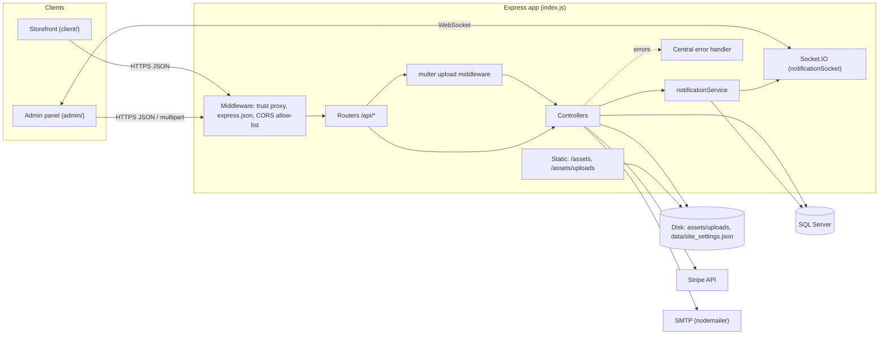

### Action-loop workflow (request lifecycle)

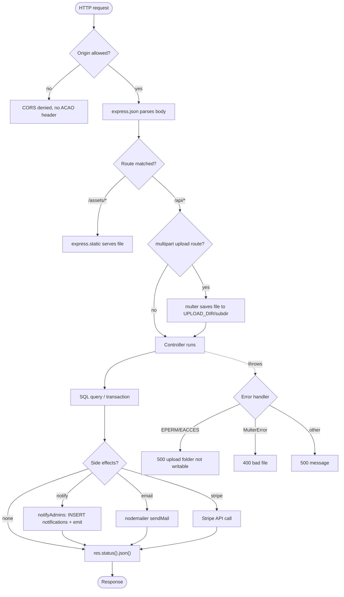

### Sequence (server boot)

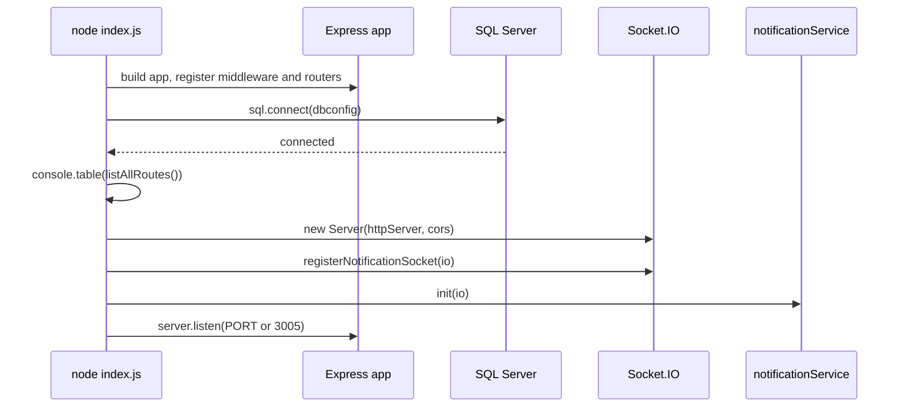

### Events / data flow

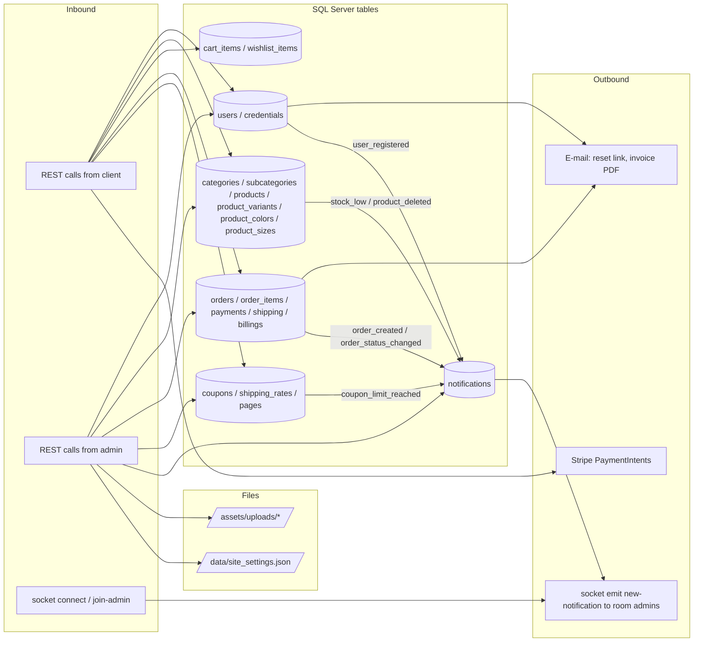

---

## 1. Auth & Users

Files: [routes/userRoutes.js](routes/userRoutes.js), [controllers/userController.js](controllers/userController.js), [middleware/auth.js](middleware/auth.js)

Endpoints: `POST /api/users/register`, `GET /api/users/check-email`, `POST /api/users/login`, `POST /api/users/forgot-password`, `POST /api/users/reset-password`, `GET /api/users`, `GET /api/users/customers`, `PUT /api/users/:id`, `DELETE /api/users/:id`.

### Architecture overview

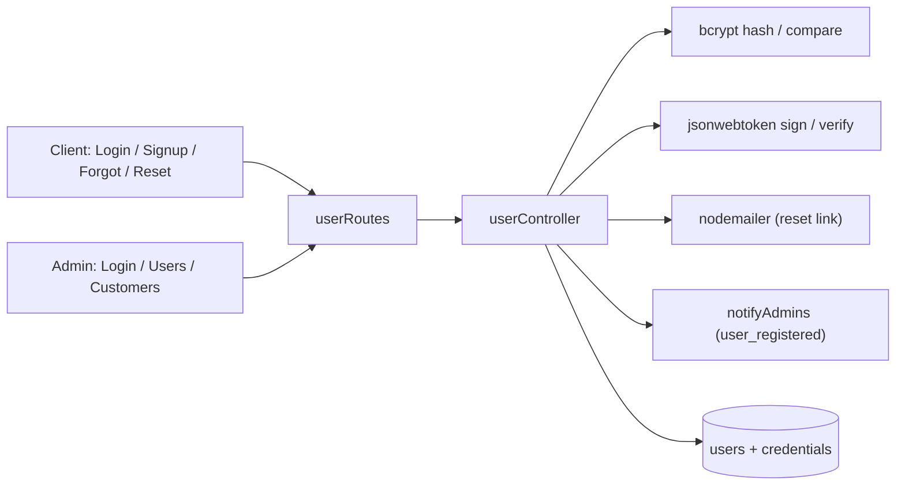

### Action-loop workflow (login)

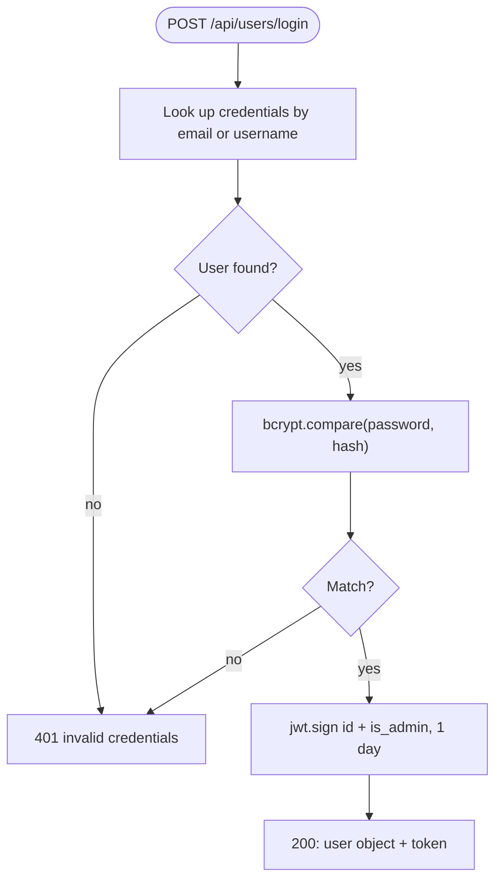

### Sequence (register, forgot & reset password)

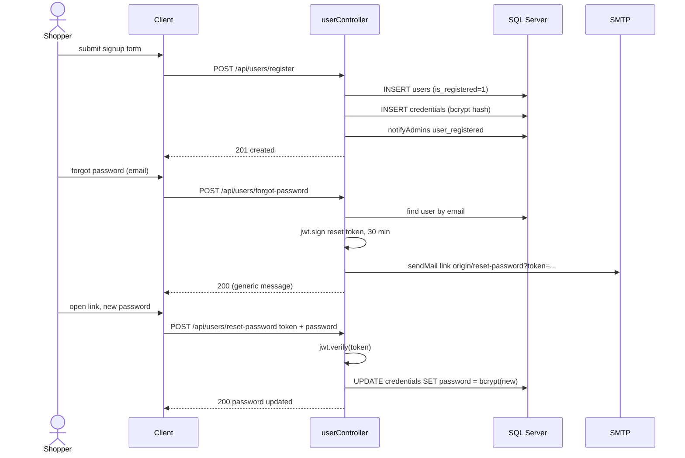

### Events / data flow

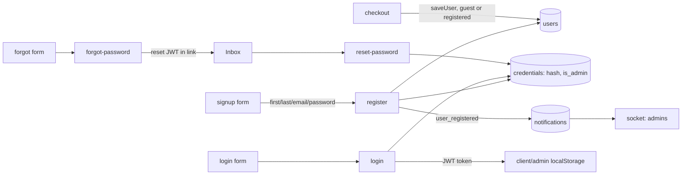

---

## 2. Catalog

Files: [routes/categoryRoutes.js](routes/categoryRoutes.js), [routes/subcategoryRoutes.js](routes/subcategoryRoutes.js), [routes/productRoutes.js](routes/productRoutes.js), [routes/colorRoutes.js](routes/colorRoutes.js), [routes/sizeRoutes.js](routes/sizeRoutes.js), [middleware/upload.js](middleware/upload.js), matching controllers.

### Architecture overview

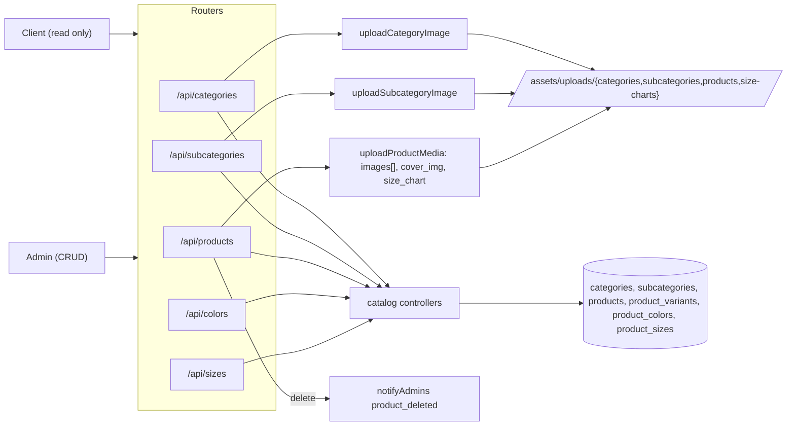

### Action-loop workflow (create / update product)

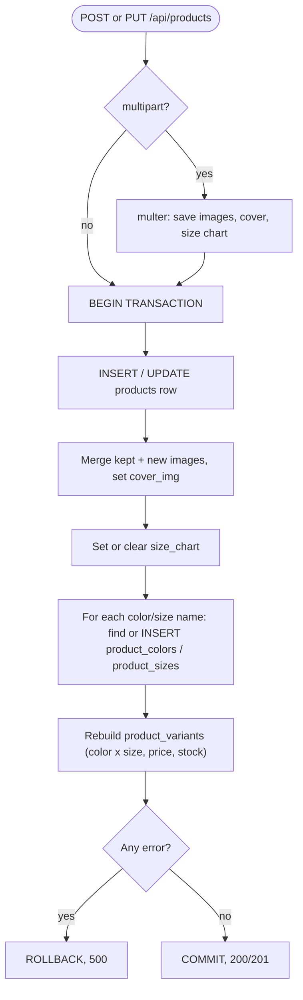

### Sequence (delete product)

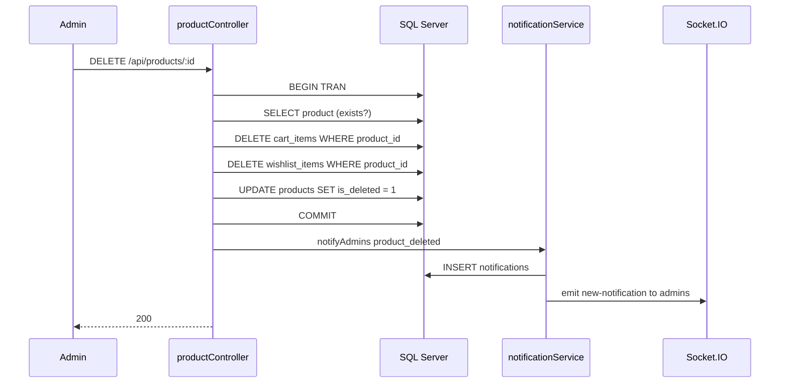

### Events / data flow

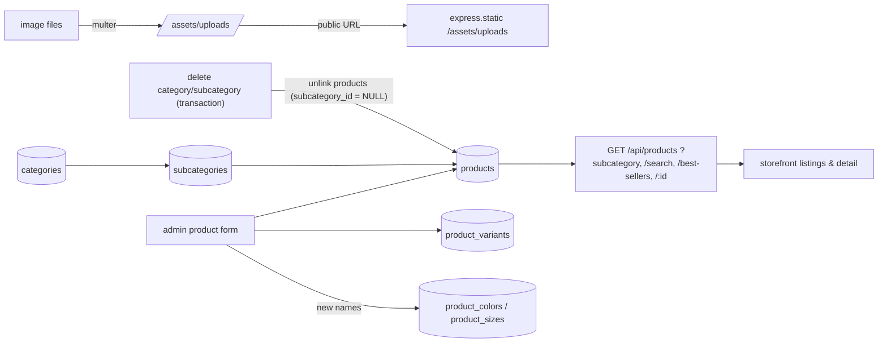

---

## 3. Cart

Files: [routes/addToCartRoutes.js](routes/addToCartRoutes.js), [controllers/addToCartController.js](controllers/addToCartController.js)

Endpoints: `POST /api/cart/add`, `POST /api/cart/add/bulk`, `GET /api/cart/:userId`, `PUT /api/cart/:cartItemId`, `DELETE /api/cart/:cartItemId`. Guest carts never reach the server until login (see client docs).

### Architecture overview

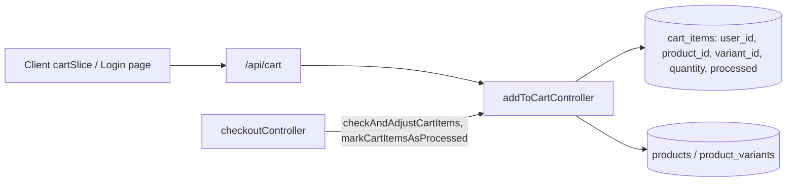

### Action-loop workflow (add / bulk add)

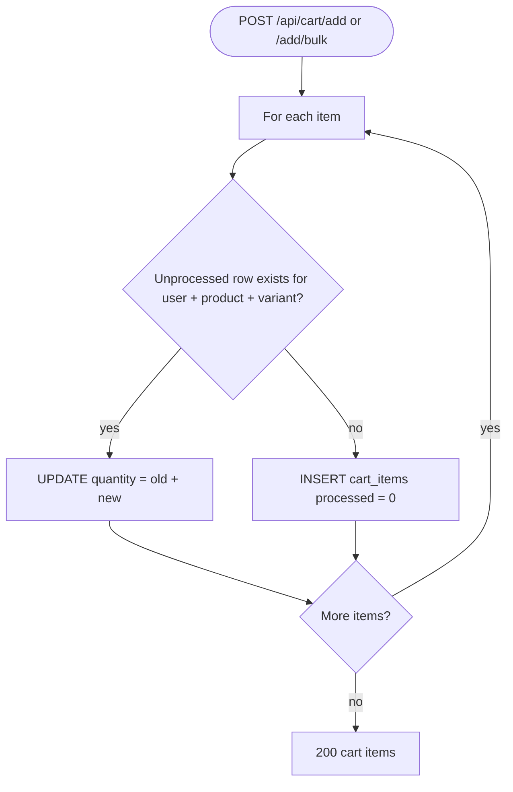

### Sequence (fetch & edit)

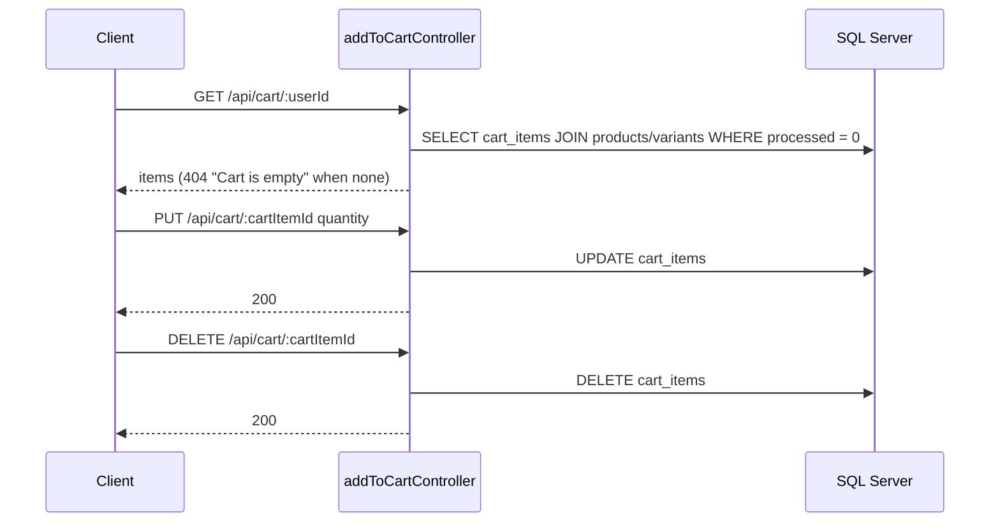

### Events / data flow

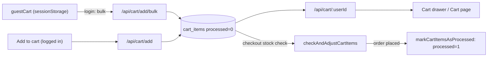

---

## 4. Wishlist

Files: [routes/wishlistRoutes.js](routes/wishlistRoutes.js), [controllers/wishlistController.js](controllers/wishlistController.js). Only `POST /api/wishlist` is mounted.

### Architecture overview

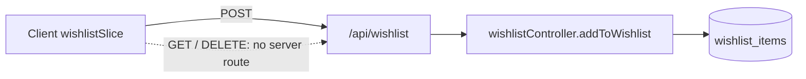

### Action-loop workflow

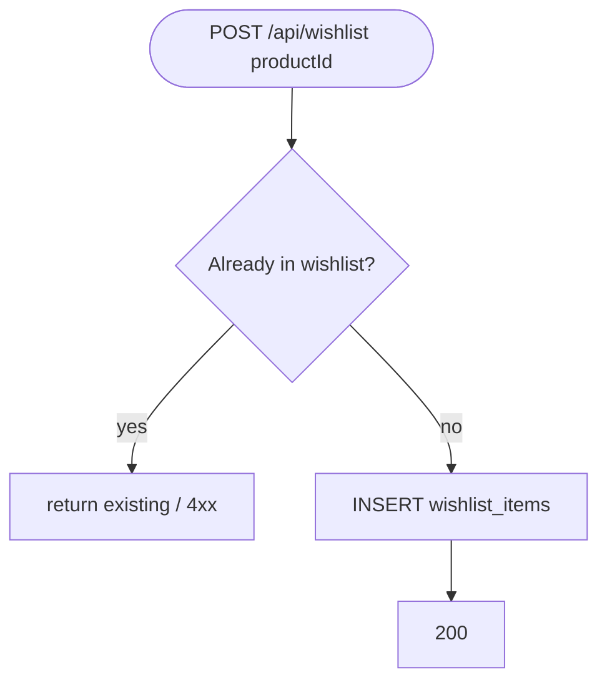

### Sequence

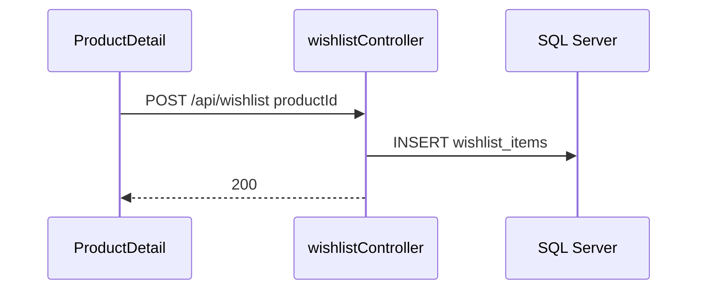

### Events / data flow

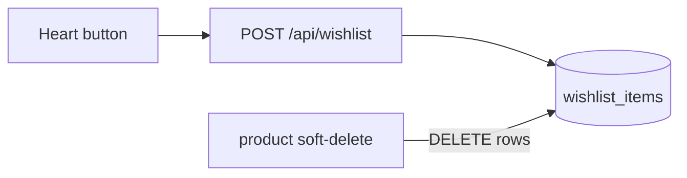

---

## 5. Payments & Checkout

Files: [routes/paymentRoutes.js](routes/paymentRoutes.js), [routes/checkout.js](routes/checkout.js), [controllers/paymentController.js](controllers/paymentController.js), [controllers/checkoutController.js](controllers/checkoutController.js), plus `orderController`, `shippingController`, `billingController`, `inventoryController`, `invoiceController`.

### Architecture overview

```mermaid
flowchart LR
    C["Client Checkout + PaymentForm"] -->|"step 1: amount"| PI["POST /api/payments/intents"]
    PI --> STRIPE["Stripe"]
    C -->|"step 2: confirmCardPayment"| STRIPE
    C -->|"step 3: payload + paymentIntentId"| CK["POST /api/checkout"]
    CK --> CC["checkoutController.doCheckout"]
    CC --> CART["addToCartController (stock check, mark processed)"]
    CC --> USR["userController.saveUser"]
    CC --> ORD["orderController.saveOrder / saveOrderItems"]
    CC --> SHP["shippingController.saveShipping"]
    CC --> BIL["billingController.saveBilling"]
    CC --> PAY["paymentController.savePayment"]
    CC --> INV["inventoryController.updateProductStock"]
    CC --> INVC["invoiceController.sendInvoiceEmail (pdfkit + SMTP)"]
    CC --> SET["siteSettings.default_intl_shipping_fee"]
    CC --> NS["notifyAdmins"]
    CC --> STRIPE
```

### Action-loop workflow (doCheckout)

```mermaid
flowchart TD
    A([POST /api/checkout]) --> B["checkAndAdjustCartItems"]
    B --> B1{"Stock OK?"}
    B1 -- no --> X1["400 + stockMessages"]
    B1 -- yes --> C["Recompute subtotal from adjusted items"]
    C --> D["Shipping fee: shipping_rates by country, else default_intl_shipping_fee, else 35"]
    D --> E{"paymentIntentId present?"}
    E -- no --> X2["400 Missing paymentIntentId"]
    E -- yes --> F["stripe.paymentIntents.retrieve"]
    F --> G{"status = succeeded?"}
    G -- no --> X3["400 Payment not confirmed"]
    G -- yes --> H["saveUser"] --> I["saveOrder status=pending"]
    I --> J["saveShipping"] --> K["saveBilling"] --> L["saveOrderItems"] --> M["savePayment"]
    M --> N{"couponCode?"}
    N -- yes --> N1["UPDATE coupons used_count+1 (guarded by usage_limit)"]
    N1 --> N2{"limit reached?"}
    N2 -- yes --> N3["notify coupon_limit_reached"]
    N2 -- no --> O
    N3 --> O
    N -- no --> O["updateProductStock (notify stock_low if <= 5)"]
    O --> P["markCartItemsAsProcessed"]
    P --> Q["notify order_created"]
    Q --> R["sendInvoiceEmail"]
    R --> S([200 orderId])
```

### Sequence

```mermaid
sequenceDiagram
    actor U as Shopper
    participant C as Client
    participant P as paymentController
    participant K as checkoutController
    participant ST as Stripe
    participant DB as SQL Server
    participant N as notificationService
    participant M as SMTP

    U->>C: Pay
    C->>ST: createPaymentMethod(card)
    C->>P: POST /api/payments/intents amount
    P->>ST: paymentIntents.create(EUR, cents)
    ST-->>P: client_secret
    P-->>C: clientSecret, paymentIntentId
    C->>ST: confirmCardPayment(clientSecret)
    ST-->>C: paymentIntent succeeded
    C->>K: POST /api/checkout payload
    K->>DB: stock check, shipping fee lookup
    K->>ST: paymentIntents.retrieve(id)
    ST-->>K: succeeded
    K->>DB: users, orders, shipping, billings, order_items, payments
    K->>DB: coupons used_count, stock decrement, cart processed=1
    K->>N: order_created (+ stock_low / coupon_limit_reached)
    K->>M: invoice PDF e-mail
    K-->>C: 200 orderId
```

### Events / data flow

```mermaid
flowchart LR
    PL["checkout payload: user_info, shipping, billing, cartItems, couponCode, paymentIntentId"] --> K["doCheckout"]
    K -->|retrieve| STR["Stripe PaymentIntent"]
    K --> U[(users)]
    K --> O[(orders status=pending)]
    K --> OI[(order_items)]
    K --> SH[(shipping)]
    K --> BI[(billings)]
    K --> PA[(payments payment_status=succeeded)]
    K --> CO[(coupons.used_count)]
    K --> PV[(products / variants stock)]
    K --> CI[(cart_items processed=1)]
    K --> NO[(notifications)] --> WS["socket new-notification"]
    K --> PDF["pdfkit invoice"] --> MAIL["customer inbox"]
    PA -.single source of truth for paid.-> DASH["/api/orders/stats"]
```

---

## 6. Orders (admin)

Files: [routes/orderRoutes.js](routes/orderRoutes.js), [controllers/orderController.js](controllers/orderController.js).
Endpoints: `GET /api/orders/stats`, `GET /api/orders`, `GET /api/orders/:id`, `PUT /api/orders/:id/status`.
Statuses used by the admin UI: `pending → processing → shipped → delivered`, or `cancelled`.

### Architecture overview

```mermaid
flowchart LR
    AD["Admin Dashboard / Orders"] --> R["/api/orders"] --> OC["orderController"]
    OC --> DB[(orders, order_items, payments, users, shipping, billings)]
    OC --> NS["notifyAdmins order_status_changed"]
```

### Action-loop workflow (status change)

```mermaid
flowchart TD
    A([PUT /api/orders/:id/status]) --> B["UPDATE orders SET status"]
    B --> C{"Row updated?"}
    C -- no --> D["404 Order not found"]
    C -- yes --> E["notifyAdmins order_status_changed"] --> F["200"]
```

```mermaid
stateDiagram-v2
    [*] --> pending: checkout
    pending --> processing
    processing --> shipped
    shipped --> delivered
    pending --> cancelled
    processing --> cancelled
    delivered --> [*]
    cancelled --> [*]
```

### Sequence

```mermaid
sequenceDiagram
    participant A as Admin
    participant O as orderController
    participant DB as SQL Server
    A->>O: GET /api/orders/stats
    O->>DB: revenue / counts (paid = EXISTS payments succeeded)
    O-->>A: totals + change
    A->>O: GET /api/orders/:id
    O->>DB: order + items + shipping + billing + latest payment
    O-->>A: detail
    A->>O: PUT /api/orders/:id/status
    O->>DB: UPDATE orders
    O-->>A: 200
```

### Events / data flow

```mermaid
flowchart LR
    O[(orders)] & P[(payments)] --> ST["stats"] --> D["Dashboard cards / Recent orders"]
    O & OI[(order_items)] & SH[(shipping)] & BI[(billings)] --> DET["order detail"] --> UI["Orders drawer"]
    UI -->|new status| O --> N[(notifications)] --> WS["socket admins"]
```

---

## 7. Coupons

Files: [routes/coupon.js](routes/coupon.js), [controllers/couponController.js](controllers/couponController.js).

### Architecture overview

```mermaid
flowchart LR
    AD["Admin Coupons page + notification actions"] -->|CRUD| R["/api/coupons"]
    CL["Client Checkout"] -->|POST /validate-coupon| R
    R --> CC["couponController"] --> DB[(coupons)]
    CK["checkoutController"] -->|used_count + 1| DB
```

### Action-loop workflow (validate)

```mermaid
flowchart TD
    A([validate code]) --> B{"Code exists?"}
    B -- no --> X["invalid"]
    B -- yes --> C{"status active and now between valid_from / valid_until?"}
    C -- no --> X
    C -- yes --> D{"usage_limit null or used_count < limit?"}
    D -- no --> X
    D -- yes --> E["return discount_type + discount_value"]
```

### Sequence

```mermaid
sequenceDiagram
    participant C as Client
    participant K as couponController
    participant CK as checkoutController
    participant DB as SQL Server
    participant A as Admin
    C->>K: POST /api/coupons/validate-coupon code
    K->>DB: SELECT coupon
    K-->>C: discount
    C->>CK: checkout with couponCode
    CK->>DB: UPDATE used_count (guarded)
    CK-->>A: notification coupon_limit_reached (if hit)
    A->>K: PUT /api/coupons/:id status=inactive or DELETE
```

### Events / data flow

```mermaid
flowchart LR
    F["admin coupon form"] --> CP[(coupons)]
    CP -->|validate| CH["checkout discount"]
    CH -->|order placed| CP
    CP -->|limit reached| N[(notifications)] --> A["admin bell: Deactivate / Delete"] --> CP
```

---

## 8. Shipping rates

Files: [routes/shipping.js](routes/shipping.js), [controllers/shippingRatesController.js](controllers/shippingRatesController.js), [utils/countries.js](utils/countries.js).

### Architecture overview

```mermaid
flowchart LR
    AD["Admin Shipping page"] -->|CRUD| R["/api/shipping"]
    CL["Client Cart / Checkout"] -->|GET / GET :country| R
    R --> SC["shippingRatesController"] --> DB[(shipping_rates)]
    CK["checkoutController"] --> DB
    CK --> SET["site_settings.default_intl_shipping_fee"]
```

### Action-loop workflow (fee resolution)

```mermaid
flowchart TD
    A([country]) --> B{"Active shipping_rates row for country?"}
    B -- yes --> C["fee = row.fee"]
    B -- no --> D{"default_intl_shipping_fee set?"}
    D -- yes --> E["fee = default"]
    D -- no --> F["fee = 35 EUR"]
```

### Sequence

```mermaid
sequenceDiagram
    participant C as Client Checkout
    participant S as shippingRatesController
    participant DB as SQL Server
    C->>S: GET /api/shipping/:country
    S->>DB: SELECT shipping_rates WHERE country
    S-->>C: fee, currency, estimated_days
```

### Events / data flow

```mermaid
flowchart LR
    AF["admin rate form"] --> SR[(shipping_rates)]
    SS[/"site_settings.json default fee"/] --> FEE
    SR --> FEE["shipping fee"] --> UI["Cart / Checkout totals"]
    FEE --> ORD["orders.total_amount"]
```

---

## 9. CMS Pages & Site Settings

Files: [routes/pageRoutes.js](routes/pageRoutes.js), [controllers/pageController.js](controllers/pageController.js), [routes/siteSettingsRoutes.js](routes/siteSettingsRoutes.js), [controllers/siteSettingsController.js](controllers/siteSettingsController.js), [data/site_settings.json](data/site_settings.json).

### Architecture overview

```mermaid
flowchart LR
    AD["Admin Pages / PageEditor / SiteContent"] --> PR["/api/pages"] --> PC["pageController"] --> DB[(pages: title, slug, content)]
    AD --> SR["/api/site-settings"] --> SC["siteSettingsController"] --> JS[/"data/site_settings.json"/]
    SR -->|upload/logo, hero, intro-image, payment-icon| UP["multer site uploads"] --> FS[/"assets/uploads/site"/]
    CL["Client usePageContent / useSiteSettings"] --> PR & SR
```

### Action-loop workflow (save settings / upload image)

```mermaid
flowchart TD
    A([PUT /api/site-settings]) --> B["loadSettings from JSON"] --> C["merge body"] --> D["writeFileSync JSON"] --> E["200 settings"]
    U([POST /upload/logo etc.]) --> V{"file present?"}
    V -- no --> X["400 No file uploaded"]
    V -- yes --> W["delete old file, store new path"] --> Y["save JSON"] --> Z["200 absolute URL"]
```

### Sequence

```mermaid
sequenceDiagram
    participant A as Admin
    participant S as Server
    participant DB as SQL Server
    participant FS as Disk
    participant C as Client
    A->>S: PUT /api/pages/:slug content
    S->>DB: UPDATE pages
    A->>S: POST /api/site-settings/upload/hero
    S->>FS: save image, update site_settings.json
    S-->>A: hero_image_url
    C->>S: GET /api/site-settings
    S-->>C: resolved settings
    C->>S: GET /api/pages/:slug
    S-->>C: page HTML
```

### Events / data flow

```mermaid
flowchart LR
    ED["React-Quill editor"] --> PG[(pages)] --> CP["client info pages: history, legal, privacy, returns..."]
    SF["SiteContent form"] --> JSON[/"site_settings.json"/] --> HOME["client hero, intro, footer, product info, payment icons"]
    IMG["uploaded images"] --> UP[/"assets/uploads/site"/] --> JSON
    JSON --> CK["checkout default shipping fee"]
```

---

## 10. Notifications

Files: [services/notificationService.js](services/notificationService.js), [sockets/notificationSocket.js](sockets/notificationSocket.js), [routes/notificationRoutes.js](routes/notificationRoutes.js), [controllers/notificationController.js](controllers/notificationController.js).

Notification types: `order_created`, `order_status_changed`, `stock_low`, `product_deleted`, `user_registered`, `coupon_limit_reached`.

### Architecture overview

```mermaid
flowchart LR
    subgraph Producers
        CK["checkoutController"]
        OC["orderController"]
        IC["inventoryController"]
        PC["productController"]
        UC["userController"]
    end
    Producers --> NS["notificationService.notifyAdmins"]
    NS --> DB[(notifications)]
    NS --> IO["io.to('admins')"]
    IO --> AH["Admin header bell"]
    AH -->|REST unread / read / mark-all| NR["/api/notifications"] --> DB
```

### Action-loop workflow

```mermaid
flowchart TD
    A([socket connect]) --> B{"auth.token present?"}
    B -- yes --> C["jwt.verify + credentials.is_admin"]
    B -- no --> D{"auth.role = admin?"}
    C --> E{"is admin?"}
    D -- yes --> J
    D -- no --> W["stay outside room; may send join-admin later"]
    E -- yes --> J["socket.join('admins')"]
    E -- no --> W
    J --> L["receives new-notification"]
```

### Sequence

```mermaid
sequenceDiagram
    participant AH as Admin header
    participant IO as Socket.IO
    participant P as Producer controller
    participant NS as notificationService
    participant DB as SQL Server
    participant R as notificationController

    AH->>R: GET /api/notifications/unread (on mount + every 30s)
    AH->>IO: connect auth token
    IO->>DB: is_admin?
    IO->>IO: join admins
    P->>NS: notifyAdmins(type, title, message, meta)
    NS->>DB: INSERT notifications OUTPUT row
    NS->>IO: emit new-notification
    IO-->>AH: notification row
    AH->>R: POST /api/notifications/:id/read
    R->>DB: is_read = 1
```

### Events / data flow

```mermaid
flowchart LR
    E1["order_created"] & E2["order_status_changed"] & E3["stock_low"] & E4["product_deleted"] & E5["user_registered"] & E6["coupon_limit_reached"] --> NS["notifyAdmins"]
    NS --> T[(notifications is_read=0)]
    NS -->|new-notification| ROOM(("room: admins"))
    ROOM --> BELL["admin bell list"]
    T -->|GET unread| BELL
    BELL -->|read / mark-all-read| T
```

---

## Notes from the code

I noticed these things while tracing the flows above. The diagrams show the code as it is.

- `middleware/auth.js` (`verifyToken`) is not attached to any router. Admin-only endpoints (products, orders, users, coupons, settings, notifications) are open to anyone.
- The socket accepts `{ role: 'admin' }` without a token and adds that connection to the `admins` room.
- `dbconfig.js` contains hard-coded DB host and credentials in a tracked file.
- Only `POST /api/wishlist` exists, but the client also calls `GET` and `DELETE` on it.
- `routes/auth.js` is never mounted. Login goes through `/api/users/login`.
